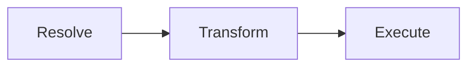

# Hugo Guide for scafctl

This guide explains how to set up and build the `scafctl` documentation site using Hugo and the Blueprint theme.

## Prerequisites

- Go 1.25+ installed
- Hugo Extended (`0.155.2+` recommended for Sass compilation)

## Installation

### Option 1: Using Homebrew (macOS)

```bash
brew install hugo
```

### Option 2: Download Binary

Download the `hugo_extended` archive from [Hugo Releases](https://github.com/gohugoio/hugo/releases) and add `hugo` to your `PATH`.

### Verify Installation

```shell
hugo version
```

## Common Commands

Hugo is run from the isolated `site/` directory so its Hugo module (`site/go.mod`) stays separate from the root Go module.

### Local Development Server

```shell
# Start the development server with live reload
hugo server -s site

# Serve on a specific port
hugo server -s site -p 8080
```

The site will be available at `http://localhost:1313/` (matching `baseURL` in `site/hugo.yaml`).

### Production Static Build

```shell
# Build to public/ with garbage collection, minification, and path checks
hugo -s site --gc --minify --printPathWarnings
```

## Project Structure

```text
scafctl/
+-- site/
|   +-- hugo.yaml          # Primary Hugo configuration and module mounts
|   +-- go.mod             # Isolated Hugo module (hugo-book)
+-- home/
|   +-- _index.md          # Landing page content (.bp-hero, .bp-pillars, walkthrough)
+-- docs/
|   +-- _index.md          # Documentation overview
|   +-- tutorials/         # Guided tutorials (walkthrough stepper enabled)
|   +-- design/            # Architecture and design docs
+-- static/
|   +-- favicon.svg        # Blueprint tile favicon
|   +-- images/            # Official brand logos, symbol, and OFL notice
+-- assets/
|   +-- _custom.scss       # @mixin theme-blueprint, CAD grid, hero, shell-toggle, stepper styles
|   +-- mermaid.json       # Dark Blueprint Mermaid theme configuration
+-- layouts/
|   +-- _default/_markup/  # Link resolution render hook (render-link.html)
|   +-- partials/docs/     # Head favicons, copy/shell-toggle JS, and walkthrough stepper partials
|   +-- shortcodes/        # Shortcode overrides (shell-toggle, shell-pane, install-tabs, hint)
+-- public/                # Generated static site (git-ignored)
```

## Content Organization

Each Markdown page starts with YAML front matter:

```yaml
---
title: "Page Title"
weight: 10
---
```

The `weight` parameter controls navigation and walkthrough order (lower numbers appear first).

### Guided Walkthrough Stepper (`docs/tutorials/`)

Regular pages under `docs/tutorials/` automatically display the Blueprint walkthrough progress bar (`STEP XX OF YY`) at the top of the page and `PREVIOUS` / `NEXT` transition cards at the bottom. Reference-only pages in `docs/tutorials/` can opt out via front matter:

```yaml
---
title: "Reference Page"
weight: 110
bpWalkthrough: false
---
```

### Section Index Files

Each section directory includes an `_index.md` file:

```yaml
---
title: "Tutorials"
weight: 1
bookCollapseSection: false
---

Introduction text for this section.
```

## Markdown Features

### Code Blocks with Syntax Highlighting

```go
// Go code with syntax highlighting
func main() {
    fmt.Println("Hello, scafctl!")
}
```

### Cross-Platform Shell Commands (`shell` Fence vs `shell-toggle`)

Use a single ```` ```shell ```` (or `~~~shell` when the snippet contains backticks) fence whenever a command runs identically in Bash and PowerShell (such as standard `scafctl` CLI invocations). Its language badge renders as `SHELL`:

~~~markdown
```shell
scafctl run solution -f solution.yaml --dry-run
```
~~~

When syntax genuinely differs between Bash and PowerShell (for example environment variables `export` vs `$env:VAR`, line continuations `\` vs `` ` ``, heredocs, or `jq` vs `ConvertFrom-Json`), use the interactive `` shortcode instead of ``. Wrap each pane's body in a fenced code block (` ```bash ` / `~~~powershell`) so the snippet also renders as copyable code when viewed directly on GitHub (`shell-pane` strips the outer fence before highlighting). The toggle auto-detects Windows vs Unix, supports Left/Right arrow keys, and persists the reader's choice across the entire site in `localStorage` (`bp-shell-pref`):

~~~~markdown


```bash
export ENVIRONMENT=production
scafctl run solution \
  -f solution.yaml
```


~~~powershell
$env:ENVIRONMENT = "production"
scafctl run solution `
  -f solution.yaml
~~~


~~~~

Reserve `` for non-shell multi-view content (such as OS installation tabs or comparing preview modes).

### Alerts / Callouts (GitHub-Flavored Markdown)

```markdown
> [!NOTE]
> Useful background context or implementation notes.

> [!TIP]
> Helpful advice or best practices.

> [!IMPORTANT]
> Key information users need to succeed.

> [!WARNING]
> Potential pitfalls or breaking behavior to watch out for.

> [!CAUTION]
> Actions that risk data loss or destructive side effects.
```

### Numbered Blueprint Steps (`steps` Shortcode)

Wrap an ordered Markdown list in `{}` (using `%` delimiters so inner Markdown renders to `<ol>`) to display numbered cyan Blueprint step rails:

~~~markdown
{}
1. **Install `scafctl`**

   ```bash
   brew install oakwood-commons/tap/scafctl
   ```

2. **Run a Solution**

   ```shell
   scafctl run solution -f solution.yaml
   ```
{}
~~~

### Tabs (`tabs` Shortcode)

~~~markdown

{}
```shell
scafctl lint --fix-dry-run --diff -f ./solution.yaml
```
{}
{}
```shell
scafctl lint --fix -f ./solution.yaml
```
{}

~~~

### Mermaid Diagrams

~~~markdown

~~~

### Collapsible Details (`details` Shortcode)

```markdown

Hidden content here.

```

## GitHub Pages Deployment

GitHub Pages builds and deploys automatically from `.github/workflows/pages.yml` on pushes to `main` touching `docs/**`, `examples/**`, `home/**`, `assets/**`, `layouts/**`, `static/**`, `pkg/authpage/assets/favicon.png`, or `site/**`.

To verify repository settings manually:

1. Open repository **Settings -> Pages**
2. Confirm **Source** is set to **GitHub Actions**

## Troubleshooting

### Module cache or theme issues

```shell
hugo mod tidy -s site
```

### Broken `.md` link warnings during build

`layouts/_default/_markup/render-link.html` resolves internal `.md` links against Hugo's content tree and emits a `WARN` line if a target does not exist. Always run `hugo -s site --gc --minify --printPathWarnings` and confirm zero `WARN` lines before opening a pull request.

## Resources

- [Hugo Documentation](https://gohugo.io/documentation/)
- [Hugo Book Theme](https://github.com/alex-shpak/hugo-book)
