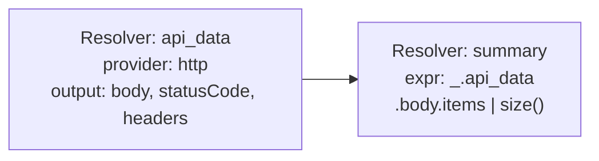

# Provider Output Shapes

Quick reference for what each built-in and official plugin provider returns in resolver and action output -- the data shape you can access via `_.resolverName` or `__actions.actionName.results` in CEL expressions and Go templates.

## How Provider Output Works

When a resolver uses a provider, the resolved value becomes accessible to downstream resolvers and actions. The **output shape** determines which fields are available:



> [!NOTE]
> **Tip:** Use the MCP tool `get_provider_output_shape` to query output schemas programmatically, or `get_provider_schema` for full provider documentation.

---

## Core Providers

### `static`
Returns the literal `inputs.value` directly across resolvers and actions (`from`, `transform`, and `action`).

| Capability | Output | Type | Description |
|-----------|--------|------|-------------|
| from / transform / action | `<value>` | any | Literal value provided in `inputs.value` |

```yaml
# Output is whatever you set as the value (in both resolvers and actions)
resolve:
  with:
    - provider: static
      inputs:
        value: "hello"
# _.my_resolver == "hello" (or __actions.my_action.results == "hello")
```

### `cel`
Returns the result of evaluating a CEL expression.

| Capability | Output | Type |
|-----------|--------|------|
| transform / action | `<expression result>` | any |

```yaml
# Output is the CEL evaluation result
transform:
  with:
    - provider: cel
      inputs:
        expression: "size(_.items)"
# _.my_resolver == 42  (or whatever the expression returns)
```

### `parameter`
Returns the value from CLI `-r key=value` flags (or replayed state parameters).

| Capability | Output | Type |
|-----------|--------|------|
| from | `<parameter value>` | any (coerced to resolver `type`) |

### `env`
Returns environment variable data depending on `operation` (`get` returns `{value, exists}` or raw value; `list` returns a map of variables).

| Capability | Output | Type |
|-----------|--------|------|
| from | `<env value / object>` | string or object |

### `state`
Reads previously persisted resolver values from the loaded state snapshot.

| Capability | Output | Type | Description |
|-----------|--------|------|-------------|
| from (`key`) | `<persisted value>` | any | Stored resolver value for `key` (or `default` when absent) |
| from (`keys` / `all: true`) | `map[string]any` | object | Map of persisted resolver values keyed by resolver name (absent keys omitted) |

---

## Identity, Credentials & Runtime Providers

### `identity`
Returns authenticated identity status, claims, group memberships, or registered handler names without exposing raw tokens.

| Capability | Fields | Type | Description |
|-----------|--------|------|-------------|
| from | `operation` | string | Executed operation (`status`, `claims`, `groups`, `list`) |
| | `handler` | string | Auth handler queried (e.g., `entra`, `github`, `gcp`) |
| | `authenticated` | bool | Whether the identity is currently authenticated |
| | `identityType` | string | Identity type (`user` or `service-principal`) |
| | `claims` | object | Parsed token claims (`email`, `name`, `subject`, `tenantId`, etc.) |
| | `tenantId` | string | Tenant ID (when applicable) |
| | `expiresAt` | string | Token expiration timestamp (RFC3339) |
| | `expiresIn` | string | Human-readable time remaining until expiry |
| | `groups` | array | Group display names (`groups` operation) |
| | `handlers` | array | Registered auth handler names (`list` operation) |
| | `count` | int | Number of items returned (`groups` / `list`) |
| | `scopedToken` | bool | `true` when derived from an on-demand scoped access token |
| | `tokenScope` | string | OAuth scope minted when `scope` input was set |
| | `tokenType` | string | Token type, typically `Bearer` (when `scope` input was set) |

### `secret`
Reads encrypted secrets from the `scafctl` secrets store.

| Capability | Operation | Output | Type | Description |
|-----------|-----------|--------|------|-------------|
| from | `get` | `<secret value>` | string | Decrypted secret value (or `default` when not found) |
| from | `list` | `[<secret name>, ...]` | array | Matching secret names |

### `metadata`
Returns runtime metadata about the `scafctl` process, host platform, and currently executing solution.

| Capability | Fields | Type | Description |
|-----------|--------|------|-------------|
| from | `version` | object | Build info: `{buildVersion, commit, buildTime}` |
| | `args` | array | Command-line arguments passed to the binary |
| | `cwd` | string | Current working directory |
| | `entrypoint` | string | Host entrypoint: `"cli"`, `"api"`, `"mcp"`, or `"unknown"` |
| | `command` | string | Command path (e.g., `"scafctl/run/solution"`) |
| | `solution` | object | Solution metadata: `{name, version, displayName, description, category, tags, source}` |
| | `os` | string | Operating system (`runtime.GOOS`, e.g., `darwin`, `linux`, `windows`) |
| | `arch` | string | CPU architecture (`runtime.GOARCH`, e.g., `amd64`, `arm64`) |
| | `shell` | string | Detected user shell (`bash`, `zsh`, `pwsh`, `powershell`, etc.) |

### `kubeconfig`
Manages kubeconfig exec-credential entries and probes Kubernetes cluster auth/reachability via its dedicated `kubeconfig` capability (invoked by `scafctl kube` or `scafctl run provider kubeconfig`).

| Capability | Fields | Type | Description |
|-----------|--------|------|-------------|
| kubeconfig | `success` | bool | Whether the operation succeeded |
| | `kubeconfig_path` | string | Path to the kubeconfig file read or written |
| | `context_name` | string | Kubeconfig context name involved |
| | `server` | string | Cluster API server URL |
| | `reachable` | bool | Whether the cluster API server responded (`reachable` operation) |
| | `removed` | bool | Whether an entry was removed (`kubeconfig_remove` operation) |
| | `auth_type` | string | Detected cluster authentication type (`detect_auth_type` operation) |
| | `oidc_issuer` | string | Detected OIDC issuer URL, when present |
| | `oauth_endpoint` | string | Detected OAuth endpoint URL, when present |
| | `username` | string | Resolved Kubernetes username (`whoami` operation) |
| | `uid` | string | Resolved user UID (`whoami` operation) |
| | `groups` | array | Resolved group memberships (`whoami` operation) |
| | `status` | int | HTTP status code, where applicable |
| | `error` | string | Error message if the operation failed |

---

## Data & Composition Providers

### `http`

| Capability | Fields | Type | Description |
|-----------|--------|------|-------------|
| from / transform | `body` | any (string or parsed JSON if autoParseJson) | Response body |
| | `statusCode` | int | HTTP status code |
| | `headers` | map[string]string | Response headers |
| action | `body` | any | Response body |
| | `statusCode` | int | HTTP status code |
| | `headers` | map[string]string | Response headers |
| | `success` | bool | Whether statusCode < 400 |

```yaml
# Access HTTP response fields
transform:
  with:
    - provider: cel
      inputs:
        expression: "_.api_data.body.items[0].name"
```

### `github`

Uses GitHub GraphQL API for reads and mutations, and REST API for releases.

| Capability | Fields | Type | Description |
|-----------|--------|------|-------------|
| from / transform | `result` | any | API response (structure varies by operation) |
| action | `success` | bool | Whether the write operation succeeded |
| | `operation` | string | The operation that was performed |
| | `result` | any | API response data |
| | `error` | string | Error message if failed |

**Read operations (`from` / `transform`) -- `result` shapes:**

| Operation | `result` type | Key fields |
|-----------|--------------|------------|
| `get_repo` | object | `name`, `full_name`, `description`, `default_branch`, `isPrivate`, `url`, `stargazerCount` |
| `get_file` | object | `name`, `content` (plain text), `sha`, `size` |
| `list_releases` | array | Each: `tagName`, `name`, `description`, `publishedAt`, `isPrerelease` |
| `get_latest_release` | object | `tagName`, `name`, `description`, `publishedAt` |
| `list_pull_requests` | array | Each: `number`, `title`, `state`, `author`, `createdAt`, `headRefName` |
| `get_pull_request` | object | `number`, `title`, `state`, `body`, `author`, `mergeable`, `isDraft` |
| `list_issues` | array | Each: `number`, `title`, `state`, `author`, `createdAt` |
| `get_issue` | object | `number`, `title`, `state`, `body`, `author`, `labels` |
| `list_issue_comments` | array | Each: `body`, `author`, `createdAt` |
| `list_branches` | array | Each: `name`, `target.oid` |
| `get_branch` | object | `name`, `target.oid` |
| `list_tags` | array | Each: `name`, `target.oid` |
| `get_head_oid` | object | `oid`, `branch` |

**Write operations (`action`) -- `result` shapes:**

| Operation | `result` key fields |
|-----------|--------------------|
| `create_issue` | `id`, `number`, `title`, `url`, `state` |
| `create_pull_request` | `id`, `number`, `title`, `url`, `headRefName`, `baseRefName` |
| `create_commit` | `oid`, `url`, `message`, `signature.isValid` |
| `create_branch` | `name`, `target.oid` |
| `create_release` | `id`, `tag_name`, `name`, `url` (REST) |

```yaml
# Access GitHub API results (read)
transform:
  with:
    - provider: cel
      inputs:
        expression: "_.repo_info.result.default_branch"

# Check write operation success (action)
transform:
  with:
    - provider: cel
      inputs:
        expression: "_.commit_result.success && _.commit_result.result.signature.isValid"
```

### `git`
Queries local or remote Git repositories and performs clone/checkout actions.

| Capability | Fields | Type | Description |
|-----------|--------|------|-------------|
| from | `operation` | string | Git operation executed (`status`, `log`, `branch`, `remote`, etc.) |
| | `result` / operation fields | any | Structured repository metadata (`branch`, `commit`, `clean`, `remotes`, etc.) |
| action | `success` | bool | Whether the Git operation succeeded |

### `file`
Returns file content, or for `write-tree`, information about written files.

| Capability | Fields | Type | Description |
|-----------|--------|------|-------------|
| from / transform | `content` | string | Raw file content |
| | `object` | any | Parsed content (only when the `parse` input is set to `json`, `yaml`, or `auto`) |
| | `path` | string | Resolved file path |
| | `size` | int | File size in bytes |
| action (`write-tree`) | `success` | bool | Whether all files were written |
| | `operation` | string | `"write-tree"` |
| | `basePath` | string | Resolved base directory path |
| | `filesWritten` | int | Number of files written |
| | `paths` | array | Relative paths of written files |

### `directory`
Returns directory listings.

| Capability | Fields | Type | Description |
|-----------|--------|------|-------------|
| from | `entries` | array | Directory entries |
| | `path` | string | Directory path |

Each entry: `{ name, path, isDir, size, modTime }`

### `solution`
Executes a sub-solution and returns its resolver values (plus workflow summary in `action` mode).

| Capability | Fields | Type | Description |
|-----------|--------|------|-------------|
| from | `resolvers` | object | Child solution resolver outputs keyed by resolver name |
| | `status` | string | Overall status: `"success"` or `"failed"` |
| | `errors` | array | Resolver errors encountered (when `propagateErrors: false`) |
| action | `resolvers` | object | Child solution resolver outputs keyed by resolver name |
| | `workflow` | object | Child workflow summary (`finalStatus`, `failedActions`, `skippedActions`) |
| | `status` | string | Overall status: `"success"` or `"failed"` |
| | `errors` | array | Errors encountered during child execution |
| | `success` | bool | Whether the sub-solution succeeded |

---

## Processing & Utility Providers

### `exec`

| Capability | Fields | Type | Description |
|-----------|--------|------|-------------|
| from / transform | `stdout` | string | Standard output |
| | `stderr` | string | Standard error |
| | `exitCode` | int | Exit code |
| | `command` | string | Full command string |
| | `shell` | string | Shell used |
| action | `success` | bool | Whether exit code is 0 |
| | `stdout` | string | Standard output |
| | `stderr` | string | Standard error |
| | `exitCode` | int | Exit code |
| | `command` | string | Full command string |
| | `shell` | string | Shell used |

```yaml
# Parse exec output
transform:
  with:
    - provider: cel
      inputs:
        expression: "_.git_info.stdout.trim()"
```

### `go-template`
Returns rendered template output directly across `transform` and `action`. For `render-tree`, returns an array of rendered entries.

| Capability | Fields | Type | Description |
|-----------|--------|------|-------------|
| transform / action (`render`) | `<rendered text>` | string | Template output as string |
| transform / action (`render-tree`) | `[{path, content}]` | array | Array of rendered file entries. Each entry has `path` (string) and `content` (string). Input entries may include an optional `data` map (shallow-merged over the shared `data`) for per-entry fan-out. |

### `hcl`
Varies by operation -- parse returns structured data, format/validate/generate return strings or structured diagnostics.

### `validation`

| Capability | Fields | Type | Description |
|-----------|--------|------|-------------|
| transform / validation | `valid` | bool | Always `true` on success |
| | `details` | string | `"all validations passed"` |

### `message`

| Capability | Fields | Type | Description |
|-----------|--------|------|-------------|
| action (text mode) | `success` | bool | Always `true` on success |
| | `message` | string | Rendered plain-text message |
| action (data mode) | `success` | bool | Always `true` on success (when `expand: false`) |
| | `data` | any | Rendered data payload (returned unwrapped when `expand: true`) |

### `debug`
Outputs formatted resolver data to `stdout`, `stderr`, or a file while returning the inspected data and formatted representation. Returns the same runtime object across all capabilities.

| Capability | Fields | Type | Description |
|-----------|--------|------|-------------|
| from / transform / validation / authentication / action | `success` | bool | Always `true` when the debug operation completes without error |
| | `result` | any | CEL-filtered or full resolver data |
| | `output` | string | Formatted debug output (`json`, `yaml`, or `pretty`) |
| | `destination` | string | Where output was written (`stdout`, `stderr`, or file path) |

### `sleep`
Pauses execution for a requested Go duration (`duration`, e.g., `"500ms"`, `"2s"`). Returns the same runtime object across all capabilities.

| Capability | Fields | Type | Description |
|-----------|--------|------|-------------|
| from / transform / validation / authentication / action | `success` | bool | Whether the sleep completed without cancellation |
| | `duration` | string | Requested sleep duration |
| | `elapsed` | string | Actual elapsed duration |

---

## Discovering Output Shapes

### CLI

```shell
# View full provider info including output schemas
scafctl get provider http -o json

# View all providers
scafctl get providers
```

### MCP Tools

```text
# Get output shape for a specific provider
get_provider_output_shape(name: "http", capability: "from")

# Get full provider docs
get_provider_schema(name: "http")
```

### In CEL Expressions

When writing CEL that references resolver output, the shape depends on the provider used:

```yaml
# HTTP provider -> access .body, .statusCode, .headers
expression: "_.api_call.body.count > 0"

# Exec provider -> access .stdout, .exitCode
expression: "_.cmd_result.exitCode == 0"

# Solution provider -> access .resolvers.<childResolver>
expression: "_.child.resolvers.endpoint"

# Static/CEL provider -> direct value
expression: "_.my_string == 'expected'"
```

---

## Next Steps

- [Provider Reference](provider-reference.md) -- complete documentation for all providers
- [CEL Expressions Tutorial](cel-tutorial.md) -- use output fields in expressions
- [Resolver Tutorial](resolver-tutorial.md) -- chain resolvers using output data
