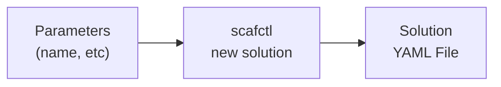

# Solution Scaffolding Tutorial

This tutorial covers using `scafctl new solution` to quickly scaffold new solution files with the correct structure, providers, and best practices.

## Overview

The `new solution` command generates a complete, valid solution YAML file based on your inputs. Instead of writing YAML from scratch (and getting field names wrong), scaffolding gives you a working starting point.



## 1. Quick Start

### Generate a Basic Solution



```bash
scafctl new solution my-app \
  -d "My application configuration" \
  --output-file my-app.yaml
```


~~~powershell
scafctl new solution my-app `
  -d "My application configuration" `
  --output-file my-app.yaml
~~~



This generates a valid solution file with:
- Correct `apiVersion` and `kind`
- Metadata with name, version, and description
- A sample resolver using the `static` provider
- An example workflow action

### Verify the Output

Immediately validate the generated file:

```shell
scafctl lint -f my-app.yaml
```

Run it:

```shell
scafctl run solution -f my-app.yaml
```

## 2. Choosing Providers

Specify which providers to include in the scaffolded solution:



```bash
# Include specific providers
scafctl new solution api-collector \
  -d "Collect data from APIs" \
  --providers http,cel,exec \
  --output-file api-collector.yaml
```


~~~powershell
# Include specific providers
scafctl new solution api-collector `
  -d "Collect data from APIs" `
  --providers http,cel,exec `
  --output-file api-collector.yaml
~~~



The generator creates resolver examples using each specified provider with correct input schemas.

### Available Providers

Not sure which providers to use? List them first:

```shell
scafctl get provider
```

Or get details on a specific provider:

```shell
scafctl get provider http
```

## 3. Starting from Examples

Instead of scaffolding from scratch, you can also start from an existing example:



```bash
# Browse available solution examples
scafctl get examples --category solutions

# Download one as a starting point
scafctl get examples solutions/email-notifier/solution.yaml > my-solution.yaml

# Modify and validate
scafctl lint -f my-solution.yaml
```


```powershell
scafctl get examples --category solutions
scafctl get examples solutions/email-notifier/solution.yaml > my-solution.yaml
scafctl lint -f my-solution.yaml
```



This is useful when you want a more complete starting point with real patterns (parameters, validation, actions, composition).

## 4. Common Scaffolding Patterns

### Resolver-Only Solution

For solutions that just gather and transform data without side-effect actions:



```bash
scafctl new solution data-collector \
  -d "Gather configuration from multiple sources" \
  --providers static,env,http,cel \
  --output-file data-collector.yaml
```


~~~powershell
scafctl new solution data-collector `
  -d "Gather configuration from multiple sources" `
  --providers static,env,http,cel `
  --output-file data-collector.yaml
~~~



Then run with the resolver command:

```shell
scafctl run resolver -f data-collector.yaml -o yaml
```

### Full Workflow Solution

For solutions with actions:



```bash
scafctl new solution deploy-pipeline \
  -d "Deployment automation pipeline" \
  --providers static,exec,cel \
  --output-file deploy-pipeline.yaml
```


~~~powershell
scafctl new solution deploy-pipeline `
  -d "Deployment automation pipeline" `
  --providers static,exec,cel `
  --output-file deploy-pipeline.yaml
~~~



### Adding Tests After Scaffolding

Once your solution works, add functional tests:



```bash
# Validate the solution
scafctl lint -f my-solution.yaml

# Use the MCP server to generate test scaffolding (if using AI tools)
# Or see the Functional Testing Tutorial for manual test writing
```


```powershell
scafctl lint -f my-solution.yaml
```



## 5. Workflow

The recommended scaffolding workflow:

1. **Scaffold** -- `scafctl new solution my-app -d "My application" --output-file my-app.yaml`
2. **Lint** -- `scafctl lint -f my-app.yaml`
3. **Edit** -- Modify resolvers and actions for your needs
4. **Lint again** -- `scafctl lint -f my-app.yaml`
5. **Test** -- `scafctl run resolver -f my-app.yaml` to verify resolvers
6. **Run** -- `scafctl run solution -f my-app.yaml` for the full workflow

## Next Steps

- [Getting Started](getting-started.md) -- Full getting started guide
- [Resolver Tutorial](resolver-tutorial.md) -- Deep dive into resolvers
- [Actions Tutorial](actions-tutorial.md) -- Build workflow actions
- [Provider Reference](provider-reference.md) -- All available providers
- [Functional Testing Tutorial](functional-testing.md) -- Add automated tests
- [Eval Tutorial](eval-tutorial.md) -- Test expressions before adding to solutions
