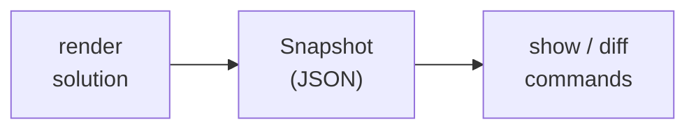

# Snapshots Tutorial

This tutorial covers using execution snapshots for debugging, testing, and comparing solution runs.

## Overview

Snapshots capture the state of resolver execution — values, timing, status, errors, and parameters — as a JSON file. They're useful for:

- **Debugging** — Inspect what every resolver produced
- **Testing** — Compare before/after to catch regressions
- **Auditing** — Record what ran and what it produced
- **Sharing** — Send a snapshot to a teammate for review (with redaction for secrets)



## When to Use Snapshots

Snapshots are **flag-triggered** (`--snapshot`), never automatically created. Here are the real-world scenarios where they provide value:

| Use Case | Scenario | How | Why Not Just Logs? |
|----------|----------|-----|-------------------|
| **Debugging a failed run** | A resolver fails or returns an unexpected value | `--snapshot` captures full state even when execution fails — you see which resolvers succeeded, which failed, and the exact error for each | Logs show temporal events; snapshots show the complete picture — every resolver's value, status, and timing in one structured file |
| **Regression detection** | You changed a solution, provider config, or parameter and need to verify nothing broke | Capture a known-good baseline, then diff after changes | `git diff` shows YAML changes; `diff snapshot` shows what those changes *did to the output* |
| **Environment comparison** | You need to see exactly which resolver values differ between staging and production | Snapshot with `-r env=staging` vs `-r env=production` and diff | Environment differences are computed at runtime by providers — they can't be seen by inspecting the solution YAML |
| **Golden-file testing** | Automated CI checks that resolver outputs haven't drifted | The `soltesting` package compares execution output against stored snapshots, normalizing timestamps and UUIDs | Manual inspection doesn't scale; golden files catch regressions automatically |
| **Audit trail** | Record what values were resolved at a specific point in time (before/after a deployment or config change) | Capture and archive snapshots with timestamps | Logs are ephemeral; snapshots are portable JSON files you can store and revisit |
| **Safe sharing** | A teammate needs to see your resolver output, but the solution uses secrets or credentials | `--redact` replaces values of `sensitive: true` resolvers with `<redacted>` | Copy-pasting terminal output risks leaking secrets and loses structure |

### Key Properties

- **Captures failures too** — Unlike normal output that stops on error, snapshots record partial state. A snapshot from a failed run shows you exactly which resolvers succeeded before the failure.
- **Structured data** — Every resolver's value, status, duration, phase, provider calls, and errors in one JSON file. Supports programmatic processing (`-o json`), CI pipeline assertions, and diff operations.
- **Redaction-safe** — Resolvers marked `sensitive: true` in the solution YAML have their values replaced with `<redacted>` when using `--redact`, making snapshots safe to share or store in version control.
- **Deterministic diff** -- `diff snapshot` with `--ignore-fields duration,providerCalls` strips non-deterministic timing data, leaving only meaningful value and status changes.

## Creating Snapshots

### From `render`

Snapshots are created with `scafctl render solution`:



```bash
# Render and save snapshot
scafctl render solution -f my-solution.yaml \
  --snapshot --snapshot-file=snapshot.json
```


~~~powershell
# Render and save snapshot
scafctl render solution -f my-solution.yaml `
  --snapshot --snapshot-file=snapshot.json
~~~



### From `run resolver`

You can also capture snapshots when running resolvers only (without actions):



```bash
scafctl run resolver -f my-solution.yaml \
  --snapshot --snapshot-file=snapshot.json
```


~~~powershell
scafctl run resolver -f my-solution.yaml `
  --snapshot --snapshot-file=snapshot.json
~~~



This is useful when you want to inspect resolver execution without triggering actions.

### With `render solution --snapshot`

Or capture a snapshot as part of a render:

```shell
scafctl render solution -f my-solution.yaml --snapshot --snapshot-file snapshot.json
```

### With Parameters



```bash
scafctl render solution -f my-solution.yaml \
  -r env=production \
  --snapshot --snapshot-file=prod-snapshot.json
```


~~~powershell
scafctl render solution -f my-solution.yaml `
  -r env=production `
  --snapshot --snapshot-file=prod-snapshot.json
~~~



### With Redaction

Redact sensitive values (resolvers marked `sensitive: true`):



```bash
scafctl render solution -f my-solution.yaml \
  --snapshot --snapshot-file=safe-snapshot.json --redact
```


~~~powershell
scafctl render solution -f my-solution.yaml `
  --snapshot --snapshot-file=safe-snapshot.json --redact
~~~



## Viewing Snapshots

### Summary View (Default)

```shell
scafctl get snapshot snapshot.json
```

Output:
```
Snapshot Summary

Solution:   my-app
Version:    1.0.0
Created:    2026-02-09T10:30:00Z
Duration:   145ms
Status:     success

Resolvers: 8 total
  ✅ Succeeded: 7
  ❌ Failed:    0
  ⏭  Skipped:   1

Parameters:
  env = production
```

### Resolver Details

```shell
scafctl get snapshot snapshot.json --detail
```

Shows each resolver's name, status, value, duration, and provider calls.

### JSON Output

```shell
scafctl get snapshot snapshot.json -o json
```

Full snapshot data for programmatic processing.

### Verbose Mode

```shell
scafctl get snapshot snapshot.json --verbose
```

Includes additional details like individual provider call timing.

## Comparing Snapshots

### Basic Diff

```shell
scafctl diff snapshot before.json after.json
```

Output:
```
Snapshot Diff

Total: 8 resolvers
  Added:     1
  Removed:   0
  Modified:  2
  Unchanged: 5

Modified Resolvers:
  replicas: 2 → 5
  log_level: "debug" → "warn"

Added Resolvers:
  + cdn_endpoint: "cdn.prod.example.com"
```

### Ignore Timing

Filter out non-deterministic fields:



```bash
scafctl diff snapshot before.json after.json \
  --ignore-fields duration,providerCalls
```


~~~powershell
scafctl diff snapshot before.json after.json `
  --ignore-fields duration,providerCalls
~~~



### Show Only Changes

```shell
scafctl diff snapshot before.json after.json --ignore-unchanged
```

### Output Formats

```shell
# Human-readable (default)
scafctl diff snapshot before.json after.json

# JSON for CI pipelines
scafctl diff snapshot before.json after.json -o json

# Save diff to file with shell redirection
scafctl diff snapshot before.json after.json -o json > diff-report.json
```

## Common Workflows

### Debugging a Failure

```shell
# 1. Capture the failing state
scafctl render solution -f broken-solution.yaml --snapshot --snapshot-file failing.json

# 2. Inspect what went wrong
scafctl get snapshot failing.json --detail --verbose

# 3. Fix the issue and re-capture
scafctl render solution -f fixed-solution.yaml --snapshot --snapshot-file fixed.json

# 4. Verify the fix
scafctl diff snapshot failing.json fixed.json
```

### Regression Testing



```bash
# 1. Capture baseline
scafctl render solution -f solution.yaml --snapshot --snapshot-file baseline.json

# 2. Make changes to the solution
# ...

# 3. Capture new state
scafctl render solution -f solution.yaml --snapshot --snapshot-file current.json

# 4. Compare (ignore timing differences)
scafctl diff snapshot baseline.json current.json \
  --ignore-fields duration,providerCalls -o json

# 5. Use exit code in CI
if ! scafctl diff snapshot baseline.json current.json \
  --ignore-fields duration,providerCalls --ignore-unchanged; then
  echo "Snapshot regression detected!"
  exit 1
fi
```


~~~powershell
# 1. Capture baseline
scafctl render solution -f solution.yaml --snapshot --snapshot-file baseline.json

# 2. Make changes to the solution
# ...

# 3. Capture new state
scafctl render solution -f solution.yaml --snapshot --snapshot-file current.json

# 4. Compare (ignore timing differences)
scafctl diff snapshot baseline.json current.json `
  --ignore-fields duration,providerCalls -o json

# 5. Use exit code in CI
scafctl diff snapshot baseline.json current.json `
  --ignore-fields duration,providerCalls --ignore-unchanged
if ($LASTEXITCODE -ne 0) {
  Write-Output "Snapshot regression detected!"
  exit 1
}
~~~



### Environment Comparison



```bash
# Capture staging
scafctl render solution -f solution.yaml -r env=staging \
  --snapshot --snapshot-file=staging.json

# Capture production
scafctl render solution -f solution.yaml -r env=production \
  --snapshot --snapshot-file=production.json

# Compare configurations
scafctl diff snapshot staging.json production.json --ignore-unchanged
```


~~~powershell
# Capture staging
scafctl render solution -f solution.yaml -r env=staging `
  --snapshot --snapshot-file=staging.json

# Capture production
scafctl render solution -f solution.yaml -r env=production `
  --snapshot --snapshot-file=production.json

# Compare configurations
scafctl diff snapshot staging.json production.json --ignore-unchanged
~~~



### Safe Sharing

```shell
# Redact secrets before sharing
scafctl render solution -f solution.yaml --snapshot --snapshot-file shareable.json --redact
```

## Examples

| Example | Description | Run |
|---------|-------------|-----|
| [basic-snapshot.yaml](../../examples/snapshots/basic-snapshot.yaml) | Basic snapshot capture | `scafctl render solution -f examples/snapshots/basic-snapshot.yaml --snapshot --snapshot-file=/tmp/snapshot.json` |
| [snapshot-diff.yaml](../../examples/snapshots/snapshot-diff.yaml) | Comparing snapshots across environments | See example header for full commands |
| [redacted-snapshot.yaml](../../examples/snapshots/redacted-snapshot.yaml) | Redacting sensitive data | `scafctl render solution -f examples/snapshots/redacted-snapshot.yaml --snapshot --snapshot-file=/tmp/redacted.json --redact` |

## Snapshot Command Reference

| Command | Description |
|---------|-------------|
| `scafctl get snapshot <file>` | Display a saved snapshot |
| `scafctl diff snapshot <a> <b>` | Compare two snapshots |
| `scafctl render solution --snapshot` | Run resolvers and save snapshot during render |

### Flags

| Flag | Commands | Description |
|------|----------|-------------|
| `-o`, `--output` | get snapshot, diff | Structured output format (get snapshot: table/json/yaml/quiet; diff: human/json/unified) |
| `--detail` | get snapshot | Show the per-resolver detail view |
| `--verbose` | get snapshot | Include additional detail |
| `--ignore-unchanged` | diff | Only show differences |
| `--ignore-fields` | diff | Comma-separated fields to ignore |
| `--output` | save | Output file path |
| `--redact` | save, render | Redact sensitive resolver values |
| `-r key=value` | save | Pass resolver parameters (also supports `@file.yaml` and `@-` for stdin) |

## Using Snapshots with the MCP Server

When using AI agents (VS Code Copilot, Claude, Cursor), the MCP server provides snapshot tools:

- **`show_snapshot`** — Display snapshot contents with structured output (same as `scafctl get snapshot`)
- **`diff_snapshots`** — Compare two snapshots and return structured diffs showing added, removed, modified, and unchanged resolvers

The `analyze_execution` prompt automatically suggests using snapshots for debugging.

## Next Steps

- [Functional Testing Tutorial](functional-testing.md) — Write and run automated tests
- [Configuration Tutorial](config-tutorial.md) — Manage application configuration
- [Resolver Tutorial](resolver-tutorial.md) — Learn about resolvers that snapshots capture
- [Cache Tutorial](cache-tutorial.md) — Manage cached data from HTTP calls
- [MCP Server Tutorial](mcp-server-tutorial.md) — AI-assisted snapshot analysis
